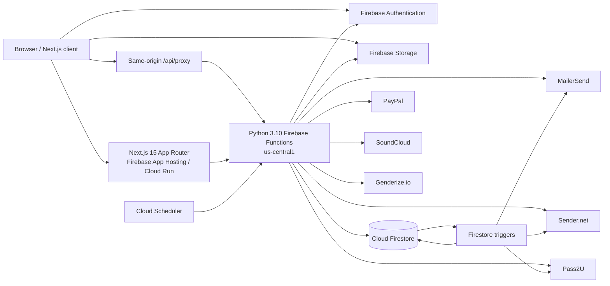
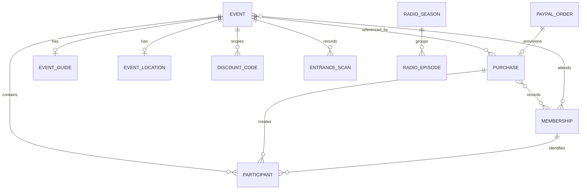
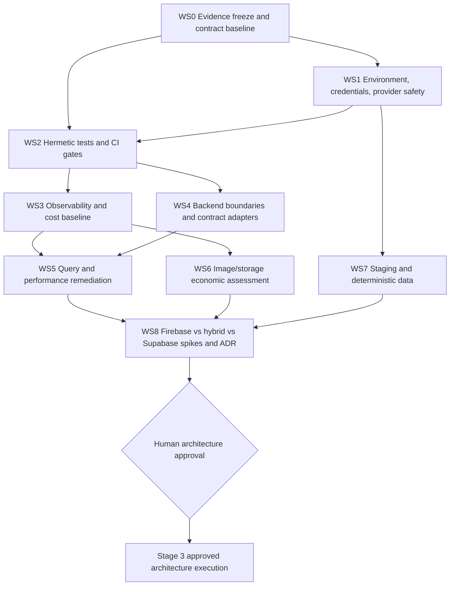

# MCP-WEB-PROJECT Current-State Assessment

**Audit date:** 2026-10-24
**Branch / commit:** `backend-modernization` / `4d7d94c0`
**Scope:** discovery, stabilization planning, and Firebase-versus-Supabase decision preparation
**Gate:** no structural implementation, production deploy, production migration, or platform selection is authorized by this document

## Evidence notation

- **[V] Verified fact** — observed in the current working tree or in a read-only runtime check.
- **[I] Inference** — strongly supported by verified facts but not directly measured.
- **[A] Unresolved assumption** — supplied context or a plausible condition that still needs evidence.
- **[R] Recommendation** — proposed next action, not an approved decision.

The repository was dirty when inspected. This assessment describes the working tree, including existing uncommitted changes. It does not attribute those changes to any person and does not treat the existing roadmap documents as approved architecture.

## 1. Executive conclusion

- **[V]** Firebase is currently the operational backend. The application has a Next.js frontend, 128 exported Firebase HTTP/callable functions, 11 scheduled/Firestore-triggered functions, Firestore, Firebase Auth, and Firebase Storage.
- **[V]** The repository already contains partial backend layering (`api`, DTOs, services, models, repositories), but the boundary is incomplete: direct Firestore access remains in request decorators, API modules, services, triggers, scripts, and the frontend Storage client.
- **[V]** The present system does not have a trustworthy change gate. There is no CI workflow; the backend emulator cannot load locally; the backend unit suite is not green; frontend lint is interactive/broken; and the production build succeeds even when build-time backend reads fail.
- **[V]** Environment isolation is unsafe. The repository declares only a production Firebase alias, local service-account JSON files remain on disk, the integration backend environment selects PayPal production, and Firebase warns that non-emulated services may affect production.
- **[V]** The code demonstrates real relational pressure: purchases, orders, memberships, participants, events, discounts, and analytics are connected by implicit identifiers and duplicated arrays. Several admin paths perform full collection scans and cross-collection aggregation in application memory.
- **[I]** PostgreSQL could materially simplify those relational and analytical workloads, but the repository currently lacks the latency, operation-count, traffic, cost, recovery, and team-capability evidence needed to choose Supabase responsibly.
- **[R]** Keep Firebase operational. Approve a first implementation workstream focused on hermetic local execution, secret/provider guardrails, a green test baseline, and CI. Only then measure and restructure business boundaries. Do not select Firebase, hybrid, or Supabase yet.

## 2. Current-state architecture map

### Runtime components

| Status | Component | Evidence and current responsibility |
|---|---|---|
| [V] | Next.js frontend | `mcp-website`; App Router, React 18, Next 15.5.19 installed. Public pages, member dashboard, admin UI, server routes, same-origin API proxy, direct Auth and Storage SDK use. |
| [V] | Firebase Functions | Python runtime configured as `python310`, region `us-central1`. `main.py` exposes API handlers by import. |
| [V] | Firestore | Primary operational data store; at least 24 named top-level collections/read models plus two nested subcollection families. |
| [V] | Firebase Auth | Admin email/password with custom claims and member passwordless links; backend validates Firebase ID tokens. |
| [V] | Firebase Storage | Event images, photo galleries, tickets, membership cards, logos, and patterns. Frontend lists, uploads, and deletes objects directly. |
| [V] | Background processing | Eight Firestore triggers and three schedules. Job documents drive location sends and analytics rebuilds. |
| [V] | External providers | PayPal, MailerSend, Sender.net, Pass2U, SoundCloud, Genderize.io; Meta Pixel and Firebase Analytics on the frontend. |
| [V] | Deployment | Firebase CLI configuration plus App Hosting config. No repository CI/CD workflow or protected promotion pipeline was found. |

## 3. Environment, credential, Firebase-resource, and integration inventory

### Environments and Firebase projects

| Status | Logical environment | Verified configuration | Gap / risk |
|---|---|---|---|
| [V] | Local frontend | `.env.local` and `.env.development` use project `mcp-website-dev-39539`; the backend URL points to the local Functions emulator. | This is a development profile, not a fully isolated local stack; startup currently fails on Functions. |
| [V] | Local backend / test | `MCP_ENV=test` loads `.env.integration`; `service_account_test.json` matches `mcp-website-dev-39539`. | `.env.integration` selects `PAYPAL_ENV=production`. Functions startup can retain live provider credentials even while Firestore is emulated. |
| [I] | Staging | Existing untracked environment design calls `mcp-website-dev-39539` staging. Its Firebase project and bucket exist. | The repository has no `staging` alias and the local development URL is not a cloud staging URL. Staging deploy behavior is not reproducible from Git. |
| [V] | Production | `.firebaserc` and `mcp-website/.firebaserc` point to `mcp-website-2a1ad`; `.env.production` points to that project and its dedicated bucket. | Production is effectively the default/only declared Firebase target. No human approval mechanism is encoded. |
| [A] | Staging data | The request states that staging contains an outdated production copy. | Not verified against cloud data during this read-only audit. Treat as a high-priority data-governance assumption to confirm. |

### Credentials

| Status | File / mechanism | Association | Current use and conclusion |
|---|---|---|---|
| [V] | `service_account.json` | Firebase production | Referenced by production `.env`, the emulator script, and Firebase config fallback. Ignored by Git and not found under this exact path in Git history. Runtime code already supports Application Default Credentials. |
| [V] | `service_account_test.json` | Firebase dev/staging | Referenced by `.env.integration` and emulator project discovery. Ignored by Git and not found under this exact path in Git history. |
| [V] | `service_account_gmail_prod.json` | Legacy Gmail production | Referenced by environment/Doppler manifest, but the current mail implementation uses MailerSend and contains no Gmail service-account load path. Likely obsolete; IAM/API usage still needs confirmation before revocation. |
| [V] | `service_account_gmail_test.json` | Legacy Gmail test | Same condition as the production Gmail file. |
| [V] | Doppler | Backend/frontend dev and prod configs are documented; JSON service accounts can be copied into Doppler as raw JSON. | Connection state, access policy, rotation, audit logging, and CI integration were not verified. Storing long-lived JSON in another secret store does not remove the key-rotation burden. |
| [V] | Browser env | Local frontend env files contain non-empty `NEXT_PUBLIC_*CLIENT_SECRET` variables. | The current application source does not reference those secret-like variables, so no bundle exposure was proven. Their presence is an unsafe convention and should be removed/rotated if ever used elsewhere. |

**[R] Credential target:** Cloud Functions/App Hosting should use runtime ADC; CI should use Workload Identity Federation; local development should use emulators and developer ADC only for explicitly approved cloud diagnostics. After usage verification, rotate Firebase keys, revoke obsolete Gmail keys, remove JSON distribution, and record the rotation date/owner. A full Git-history secret scan is still required because checking exact filenames is not a content scan.

### Firebase resources

| Status | Resource | Inventory |
|---|---|---|
| [V] | HTTP/callable definitions | 134 decorated definitions: 107 admin, 20 public, 6 member, 1 callable. Six legacy admin definitions are not exported from `main.py`; 128 are export candidates. |
| [V] | Firestore triggers | Purchases, participants, entrance scans, memberships, location jobs, and analytics jobs. Participant and membership creation also trigger registration side effects. |
| [V] | Scheduled functions | Nightly analytics rebuild at 05:15 Europe/Rome; stale-data cleanup at 03:00; yearly membership invalidation at 00:00 on January 1. |
| [V] | Firestore indexes | Root config defines seven composite indexes and three field overrides. `mcp-website/firestore.indexes.json` is empty. Which file deploys depends on working directory. |
| [V] | Firestore rules | Root and frontend copies are nearly identical but cover only a subset of the collections used by Admin SDK code. |
| [V] | Storage rules | Root and frontend copies differ materially. Root allows any authenticated user to write `events/{file}`; frontend copy requires admin and also defines public photo paths. |
| [V] | Storage buckets | Development/staging and production use different Firebase Storage bucket names. |
| [V] | Function configuration | Region is `us-central1`; no function-level memory, timeout, min-instance, max-instance, or concurrency configuration was found. App Hosting has separate Cloud Run settings. |

### External integrations

| Status | Provider | Responsibility | Isolation / reliability gap |
|---|---|---|---|
| [V] | PayPal | Create/capture event orders. | Exact string `sandbox` selects sandbox; every other value selects production. Local integration env currently selects production. Capture is followed by non-atomic Firestore provisioning. |
| [V] | MailerSend | Transactional email. | Configured globally at import; real integration tests exist and can use a live key. No default local fake adapter. |
| [V] | Sender.net | Marketing contacts, groups, campaigns, transactional sends, webhook. | Broad API surface and sync side effects. Existing roadmap says “remove Sender,” but that is not part of the supplied requirements and remains an open product decision. |
| [V] | Pass2U | Membership wallet passes. | Live adapter is reachable from membership flows/triggers; local fake is not the default architecture. |
| [V] | SoundCloud | Radio metadata/token. | OAuth token is cached in the general `settings` collection. |
| [V] | Genderize.io | Participant gender enrichment in a Firestore trigger. | Trigger performs a network call; timeout/retry/consent semantics need explicit review. |
| [V] | Meta/Firebase Analytics | Frontend analytics. | Environment behavior exists, but no consolidated operational dashboard or cost correlation was found. |

## 4. API and contract inventory

The exhaustive endpoint table is in [API_CONTRACT_INVENTORY_2026-10-24.md](API_CONTRACT_INVENTORY_2026-10-24.md).

### Contract-level findings

- **[V]** There is no OpenAPI document, generated client, versioned error envelope, or consumer-driven contract suite.
- **[V]** Refactored handlers use Pydantic DTOs, but legacy handlers still parse raw dictionaries and query parameters.
- **[V]** Frontend config declares four slugs with no backend definition: `admin_upload_event_photo`, `get_all_questions`, `newsletter_participants`, and `signup_request`.
- **[V]** Six decorated admin functions in `api/admin/admin.py` are not imported by `main.py` and therefore are not function exports.
- **[V]** The active messages service references `endpoints.admin.getMessageById`, which is not defined.
- **[V]** Legacy frontend services reference missing nested keys such as `endpoints.admin.questions.*` and obsolete flat newsletter/signup keys.
- **[V]** `get_settings` is implemented with the public decorator and returns all settings when no key is supplied; `get_setting` separately enforces a key. The sensitivity of current setting values is unknown.
- **[R]** Freeze tier-1 contracts with black-box tests before changing envelopes or renaming fields. Generate OpenAPI only after current observable behavior and intentional compatibility rules are agreed.

## 5. Current business-logic locations

| Status | Location | Examples | Assessment |
|---|---|---|---|
| [V] | Domain helpers | `domain/event_rules.py`, `membership_rules.py`, `participant_rules.py` | Positive start: pure rules exist and are independently testable. |
| [V] | Services | Payments, analytics, memberships, participants, location, mail, Sender, radio | Main business layer, but several services are very large: analytics snapshot 1,056 lines, payment 808, analytics 725, Sender 606, memberships 547, location 524. |
| [V] | API handlers/decorators | `members_auth_api.py` scans Firestore directly; `require_active_event` reads Firestore. | Transport/auth and data access remain coupled. |
| [V] | Triggers | Registration trigger enriches participants, creates/sends documents, provisions Auth users, and syncs Sender; analytics triggers rebuild read models. | Business rules and external side effects are coupled to Firebase event delivery. |
| [V] | Repositories | Firestore-specific CRUD and query code; protocols exist for many repositories. | Useful seam for platform assessment, but generic base methods encourage unbounded reads. |
| [V] | Frontend | Direct Firebase Storage listing/upload/delete, Auth/session handling, handwritten API services, some business validation. | Storage ownership and contracts are not confined to backend adapters. |
| [V] | Repair/migration scripts | Membership cleanup, reconstruction, fixes, renewal, diagnostics, and seeding. | The number of repair scripts is evidence that important invariants are not fully enforced at write time. One new repair script is ignored/untracked because of broad ignore rules. |

**[R] Proposed boundary, subject to design approval:** transport/decorators → schema validation → application use case → pure domain rules → repository ports/provider ports. Firebase triggers should translate events into idempotent use-case commands; frontend components should consume a typed client; provider adapters should be replaceable with fakes. Do not reorganize files until contract tests and dependency seams are approved.

## 6. Preliminary Firestore data model

### Collections and read models

| Status | Collection/path | Role and key relationships |
|---|---|---|
| [V] | `events/{eventId}` | Event aggregate; title/date/status/pricing/capacity/photo metadata. |
| [V] | `participants/{eventId}/participants_event/{participantId}` | Event attendee; repeats `event_id` and references `membershipId`, `purchase_id`, and `discountCodeId`. |
| [V] | `memberships/{membershipId}` | Member record; embeds arrays of purchase IDs, attended event IDs, renewal records, and years; optional Firebase Auth `uid`. |
| [V] | `purchases/{purchaseId}` | Captured payment/business purchase; event relation via `ref_id`/`event_id`, array of membership IDs, discount references. |
| [V] | `orders/{paypalOrderId}` | Pre-capture checkout snapshot; embeds cart, participants, membership targets/lookup, totals, event snapshot, discount data, and eventual purchase ID. |
| [V] | `discount_codes/{discountCodeId}` | Event-scoped code with optional membership/email restriction and mutable use counter. |
| [V] | `event_guides/{eventId}` / `event_locations/{eventId}` | One-to-one event extensions keyed by event ID. |
| [V] | `entrance_scans/{eventId}/scans/{membershipId}` | Attendance/check-in state. |
| [V] | `scan_tokens/{token}` | Temporary scanner session token. |
| [V] | `admin_users/{uid}` / `users/{uid}` | Admin metadata and user profile; Firebase Auth remains identity authority. |
| [V] | `membership_settings/*` / `settings/*` | Prices, wallet model, general settings, and SoundCloud OAuth token. |
| [V] | `newsletter_signups`, `newsletter_consents`, `newsletter_participants`, `contact_message` | Communication/contact data. |
| [V] | `radio_seasons`, `radio_episodes` | Radio content; episode references season by ID. |
| [V] | `jobs`, `location_jobs`, `analytics_jobs` | Asynchronous work state. |
| [V] | `analytics_dashboard/current`, `analytics_global/current`, `analytics_event/{eventId}` | Derived read models/materialized snapshots. |

### Relationship model

- **[V]** Referential integrity is implemented by convention and repair scripts, not database foreign keys.
- **[V]** The same relationships appear in multiple representations: parent path, scalar IDs, arrays, and embedded snapshots.
- **[I]** This duplication is a primary source of expensive lookups, inconsistent records, reconciliation work, and migration complexity.
- **[R]** Before any SQL migration, measure cardinalities and inconsistency rates, then define canonical entity ownership and invariants. A document-to-row copy would preserve current ambiguity rather than solve it.

## 7. Confirmed fragilities and bottlenecks

### Runtime and delivery

- **[V]** Firebase CLI 14.26.0 reports the root `functions` configuration as schema-invalid/ambiguous, although it continues.
- **[V]** Firestore and Auth emulators start; Functions discovery fails because the Python interpreter selected by Firebase cannot import `pydantic`.
- **[V]** The checked-in virtualenv is path-fragile: its `pytest` launcher shebang points to the repository's former location.
- **[V]** Python 3.10 emits an unsupported-version warning from current Google libraries.
- **[V]** Firebase warns that Storage, Pub/Sub, Hosting, and other non-started emulators may affect production. The local script normally starts only selected services.
- **[V]** There is no CI configuration in the repository.
- **[V]** `npm run lint` invokes deprecated `next lint` and enters an interactive setup prompt, making it unusable as a CI gate.
- **[V]** `npm run build` exits successfully even though build-time API calls fail with `ECONNREFUSED 127.0.0.1:5002`; static paths can therefore be silently incomplete.
- **[V]** A residual `.env.local` is loaded before `.env.production` during the production build. The observed build used the local backend URL despite being an optimized production build.

### Data access and performance

- **[V]** Generic repository `get_all`/`stream` methods and many domain-specific list methods have no limit or cursor.
- **[V]** `StatsService.get_general_stats` scans memberships, purchases, events, and participants and performs multiple additional queries sequentially.
- **[V]** Dashboard KPI/analytics code repeatedly scans all events, purchases, memberships, messages, and per-event participant subcollections.
- **[V]** Participant counts use `sum(1 for ...stream())` rather than Firestore count aggregation or maintained counters.
- **[V]** Cleanup schedules scan entire collections and filter in Python before deleting.
- **[V]** Image listing uses `listAll`, then slices client-side; the five-minute cache is process-local/browser-local and bounded only by folder count.
- **[V]** Public photo routes return `private` cache headers, limiting shared-edge caching. Uploads mark objects immutable for one year while fixed names such as `cover.jpg` can be overwritten, creating invalidation risk.
- **[I]** Admin latency and Firestore cost will grow approximately with total collection cardinality in several paths, independent of result size.

### Consistency and side effects

- **[V]** PayPal capture marks an order captured, claims a discount, creates a purchase, creates/renews memberships, updates arrays, creates participants, and finally marks completion across separate writes.
- **[V]** If provisioning fails after capture, subsequent calls intentionally raise `ORDER_PROVISIONING_INCOMPLETE`; there is no recovery worker in the current flow.
- **[V]** Registration triggers perform external calls and writes after Firestore creation events. Trigger retries can therefore repeat side effects unless every adapter path is idempotent.
- **[V]** Transactional protection exists for job claiming and discount usage, but not for the complete payment/provisioning workflow.

### Security and configuration

- **[V]** CORS is `*` for all HTTP functions, including token-protected admin functions.
- **[V]** The same-origin Next proxy forwards arbitrary backend function paths/methods and most incoming headers.
- **[V]** The member session route stores an unverified raw Firebase ID token in an HTTP-only cookie; middleware checks only cookie presence. Backend member endpoints do validate the token, so backend authorization still exists.
- **[V]** Storage rules and index files differ by deployment root, creating configuration-dependent security and performance behavior.
- **[V]** `get_settings` publicly returns all settings when called without a key.
- **[A]** Actual sensitivity of current `settings` documents is unknown; SoundCloud stores a token in that collection through Admin SDK code, so exposing the collection wholesale is especially unsafe until verified.

### Documentation and dead code

- **[V]** `CLAUDE.md` describes Next.js 13 while the installed application is Next.js 15.5.19; the file is ignored and not versioned.
- **[V]** `ENTITIES.md` references a missing `migrate_locations.py` script.
- **[V]** Existing untracked restructuring plans include an admin redesign, Google Drive/Sheets work, and a Cloudflare R2 direction. Those conflict with the present non-goals or pre-decide later choices and must not be treated as approved scope.
- **[V]** Frontend pages of 1,000–1,800 lines and duplicate/legacy service modules indicate hidden coupling and high change cost.

## 8. Runtime checks and baseline limitations

| Status | Check | Result |
|---|---|---|
| [V] | Frontend dev startup | Ready in 1.85 s. `/`, `/events`, and `/admin` returned 200. First page compilation/request took 3.38 s; subsequent sampled pages 0.58–0.66 s. Server logs showed backend connection failures, so 200 is not an end-to-end success signal. |
| [V] | Frontend production build | Passed in about 13 s with repeated backend connection failures during page-data/static-path generation and a Firebase/protobuf dynamic-dependency warning. |
| [V] | Frontend lint | Failed as a non-interactive gate because `next lint` prompted for configuration. |
| [V] | Backend emulator | Firestore/Auth started. Functions discovery failed with `ModuleNotFoundError: pydantic`. |
| [V] | Backend unit collection | 547 tests collected. Run was interrupted after 93.57 s because retries waited on unavailable emulator services: 72 passed, 28 failed, and most tests had not run. Many failures show current handler/test contract drift. |
| [V] | Backend integration collection | 283 tests collected but not executed because the local Functions/emulator baseline is unsafe and broken. Some integration tests can call real providers when configured. |
| [V] | Frontend automated tests | One test file was found; no `test` script exists in `package.json`. |
| [V] | Production read-only sample from Europe/Rome workstation | Three calls each: `get_next_event` 259–383 ms/3 B, `get_all_events` 329–393 ms/12,704 B, `get_membership_price_public` 253–337 ms/29 B. All returned 200. This is not a cold-start or statistically valid p95 baseline. |

## 9. Performance and cost measurement gaps

| Status | Missing evidence | Required collection method |
|---|---|---|
| [V] | Per-endpoint p50/p95/p99, cold/warm split, error rate | Structured request timing and Cloud Monitoring dashboard, segmented by function/revision/environment. |
| [V] | Firestore reads/writes/query count per request | Repository instrumentation in emulator/staging plus Cloud Monitoring usage correlation. |
| [V] | Query cardinality and index selectivity | Synthetic datasets at agreed sizes and Firestore query explain/operation counters where available. |
| [V] | Function bundle/import time, memory, CPU, instance count, concurrency | Build artifact inspection and Cloud Run/Functions runtime metrics. |
| [V] | External provider latency/error/retry rates | Timed adapter spans with provider/operation/status classification. |
| [V] | Image origin bytes, egress, cache hit ratio, transformation demand, hotlinking | Storage billing export, access logs/CDN analytics, and representative page traces. |
| [V] | Environment-level infrastructure cost | Billing export labeled by project/service/SKU; at least 90 days if available. |
| [V] | Cost at growth levels | Replay/calculation at current, 10×, and 50× traffic/data profiles. |
| [V] | Maintenance cost | Team time for incidents, deploys, data repair, schema changes, and provider operations. |

## 10. Risk register

| Rank | Severity | Status | Risk | Impact | Immediate treatment |
|---:|---|---|---|---|---|
| 1 | Critical | [V] | Non-production backend env selects PayPal production; provider selection fails open to live unless value is exactly `sandbox`. | Accidental real charges or live API activity during local/staging work. | Fail startup for any non-production/live combination; default to mock; isolate live secrets. |
| 2 | Critical | [V] | PayPal capture provisioning is non-atomic and lacks automated recovery after money capture. | Paid customer can lack purchase, membership, or ticket records; manual repair and double-action risk. | Define state machine, idempotency keys, recovery/reconciliation before feature work. |
| 3 | Critical | [V] | No reliable CI/release gate; build can pass with failed data generation; production is the only declared alias. | Broken or misconfigured release can reach production without evidence or approval. | Establish environment guardrails and required CI before refactoring. |
| 4 | High | [V] | Local Functions emulator is not reproducible and can leave non-emulated services pointed at cloud resources. | Developers/tests can hit cloud or cannot validate changes locally. | Hermetic toolchain, all required emulators/fakes, deny cloud by default. |
| 5 | High | [V]/[A] | Public all-settings endpoint; actual stored sensitivity unclassified. | Potential disclosure of operational tokens/configuration. | Restrict immediately in the first approved change; audit current documents without copying values into reports. |
| 6 | High | [V] | Long-lived service-account JSON files exist on developer disk and are designed to be copied to Doppler. Rotation state is unknown. | Credential theft and broad cloud access. | Inventory IAM usage, rotate, move runtime/CI to ADC/WIF, remove files. |
| 7 | High | [V] | Duplicate Firebase rules/index configs have drifted. | Security or query behavior changes based on deploy directory. | One canonical config and CI diff/deploy validation. |
| 8 | High | [V] | Backend test suite is not green; integration boundaries are not hermetic; frontend test coverage is negligible. | Refactors can silently break payments, auth, storage, and admin flows. | Stabilize test harness and define tier-1 regression suite. |
| 9 | High | [V] | Unbounded scans, per-event loops, in-memory aggregation, and client-side `listAll`. | Latency and cost grow with total data; admin endpoints become unreliable. | Instrument first; paginate, aggregate, index, and precompute based on measurements. |
| 10 | High | [A] | Staging contains an outdated production copy. | Privacy, retention, email/payment side effects, non-deterministic testing. | Confirm, quarantine, then replace with synthetic persistent and generated volumetric data under an approved reset plan. |
| 11 | High | [V] | API/client drift and missing endpoint keys. | Hidden dead paths and runtime failures during refactor. | Freeze inventory; contract tests; remove only after usage evidence. |
| 12 | High | [V] | No request correlation, dependency timing, SLOs, or cost anomaly alerts. | Root cause and cost spikes cannot be attributed quickly. | Add minimum observability before optimization. |
| 13 | Medium | [V]/[I] | Functions are fixed in `us-central1`; primary users appear Europe-based. | Avoidable network latency and data-location concerns. | Measure client geography and cross-region latency; include relocation cost/risk in ADR. |
| 14 | Medium | [V] | Python 3.10/runtime and dependency/tooling drift. | Security/support risk and irreproducible developer environments. | Pin supported Python/tool versions and rebuild environment from lockable inputs. |
| 15 | Medium | [V] | Mutable image names use immutable caching; edge caching/origin controls are weak. | Stale images, repeated downloads, unpredictable egress. | Measure lifecycle and correct cache/versioning semantics before choosing a CDN. |

## 11. Proposed workstreams and dependencies

| Workstream | Status | Outcome | Depends on |
|---|---|---|---|
| WS0 — Evidence freeze | [R] | Version current architecture, endpoint inventory, critical flows, and baseline commands; define tier-1 contracts. | Approval of this discovery package. |
| WS1 — Environment and secret safety | [R] | Canonical Firebase config, explicit aliases, fail-closed environment matrix, reproducible Python/Node toolchain, all-emulator local mode, mock providers, ADC/WIF, credential rotation plan. | WS0. |
| WS2 — Tests and CI | [R] | Green unit baseline, emulator integration suite, contract checks, frontend test runner, non-interactive lint/type/build, PR/staging/production gates. | WS1. |
| WS3 — Observability/cost | [R] | Request IDs, structured logs, endpoint/dependency timings, dashboards, billing export, alert thresholds, benchmark harness. | WS1 and enough of WS2 to trust measurements. |
| WS4 — Backend boundaries | [R] | Approved ports/use-case/domain design; move direct Firestore/provider calls behind interfaces without changing public behavior. | WS0 contracts and WS2 safety net. |
| WS5 — Performance | [R] | Pagination, query/index changes, counters/read models, background work, cache policy, function tuning based on evidence. | WS3 baseline and WS4 seams. |
| WS6 — Images/storage | [R] | Lifecycle and cost model; compare Firebase direct, Firebase + CDN/image layer, Cloudflare offerings, and other providers. | WS3 traffic/cost evidence. |
| WS7 — Staging/test data | [R] | Persistent synthetic scenarios, deterministic volumetric generator, tagged cleanup, stable test identities, PayPal sandbox only, no raw production copy. | WS1 safety; destructive cleanup needs separate approval. |
| WS8 — Platform assessment | [R] | Representative Firebase optimization and Supabase/Postgres spikes, neutral cost/risk scorecard, formal ADR. | WS3–WS7 evidence. |

## 12. Measurable restructuring success criteria

| Area | Proposed criterion |
|---|---|
| Environment isolation | Automated tests prove local/test cannot resolve production project IDs, buckets, PayPal live, or production provider secrets; startup fails closed on an invalid matrix. |
| Reproducibility | A clean machine can install pinned dependencies and start frontend + required emulators + mock providers with one documented command; no service-account JSON is required. |
| Tests | 100% of the approved tier-1 business rules have unit tests; tier-1 API/Firestore/Auth/Storage flows pass in emulators; no default test performs network calls. |
| Contracts | Every exported endpoint has owner, access class, request/response/error schema, consumer list, and compatibility test; zero unresolved frontend endpoint references remain. |
| CI/CD | Pull requests require install, secret scan, lint, type/build, unit, integration, and contract gates; production requires explicit human approval and a tested rollback artifact. |
| Observability | 100% of HTTP requests have environment, function, correlation ID, outcome, total duration, and dependency timings without secrets/PII; tier-1 alerts have an owner/runbook. |
| Performance | Baseline p50/p95/p99 and Firestore operation counts exist for every tier-1 endpoint; top five expensive admin endpoints improve p95 and read count by at least 40% on the agreed volumetric dataset, without contract regression. |
| Query safety | All list endpoints have documented maximum page size/cursor behavior; no request path performs an unbounded collection scan unless explicitly approved as an offline job. |
| Payments | Capture/provisioning is idempotent, recoverable, reconciled, and tested for failure after every state transition; no paid order remains unreconciled beyond the agreed SLO. |
| Staging data | Persistent scenarios survive deploys; volumetric runs are deterministic/tagged/removable; automated checks find no unmodified production PII or live payment identifiers. |
| Images/cost | Origin bytes, cache hit ratio, transformations, storage, and egress cost are measurable per environment; the chosen option has a documented cost curve and rollback. |
| Platform ADR | All three alternatives use the same workload/traffic assumptions, include engineering and operational cost, identify evidence gaps, and stop at human approval. |

## 13. Recommended first implementation workstream

**[R] Start with WS1: environment, credential, and provider safety, paired with the minimum WS2 harness needed to prove it.**

This is the dependency root: backend restructuring, performance work, test-data cleanup, and platform spikes are not safe while local startup can select live PayPal, the Functions emulator cannot load, Firebase config changes by working directory, and builds/tests can pass or hang for the wrong reasons.

Proposed first slice after approval:

1. Add tests for the environment matrix before changing configuration.
2. Define `local | test | staging | production` as the only valid runtime values.
3. Make PayPal and every write-capable external provider fail closed outside its allowed environment; default local/test to fakes.
4. Choose one canonical Firebase config/rules/index set and explicit project aliases; add a production-ID denylist to local/test commands.
5. Replace the path-broken virtualenv with pinned, recreatable Python dependencies and a supported runtime.
6. Start Firestore, Auth, Storage, Pub/Sub, and Functions emulators together, or prevent Functions from starting when required dependencies are absent.
7. Establish a green, offline unit subset and a green emulator smoke suite.
8. Add initial PR CI with secret scanning, non-interactive lint/build, and the two green suites.
9. Inventory/rotate service accounts and move cloud/CI authentication to ADC/WIF.

This slice deliberately avoids changing business behavior, schemas, endpoint contracts, data, or production.

## 14. Firebase versus hybrid versus Supabase assessment plan

### Alternatives to test

| Alternative | Evidence-backed hypothesis | Primary risk to test |
|---|---|---|
| Remain on Firebase | Query redesign, pagination, aggregation queries, counters/read models, better Functions configuration, and clean boundaries may solve current pain with the lowest migration risk. | Firestore remains awkward/expensive for increasingly relational admin/reporting workloads. |
| Deliberate hybrid | Firebase Auth/realtime/event flows can remain while a bounded relational/read-model domain moves to PostgreSQL. | Dual writes/synchronization, two authorization models, and unclear source-of-truth boundaries may cost more than they save. |
| Progressive Supabase/PostgreSQL | Explicit relationships, joins, constraints, SQL aggregation, migrations, and local Postgres may improve correctness and maintainability. | Migration, RLS/auth integration, trigger replacement, operational ownership, and rollback complexity may outweigh gains at current scale. |

### Evidence and benchmarks required

1. **Data profile:** collection counts, document-size distributions, relationship fan-out, invalid/orphan/duplicate rates, array growth, index count/size, retention.
2. **Traffic profile:** requests per endpoint, concurrency, geographic distribution, read/write ratios, cold-start frequency, image requests/bytes.
3. **Representative workloads:** public event reads; admin dashboard; participant list/search; membership lookup/history; PayPal capture/provisioning; analytics rebuild; photo gallery listing/delivery.
4. **Firebase optimized baseline:** current behavior plus bounded queries, correct indexes, count aggregation, derived read models, and realistic Function settings.
5. **PostgreSQL spike:** redesigned schemas for one bounded representative domain; joins/aggregations, constraints, migrations, RLS, backup/restore, and test setup.
6. **Hybrid spike:** one-way ownership/read-model flow only; measure lag, failure recovery, replay, reconciliation, and operational burden. Reject any design that needs uncontrolled bidirectional sync.
7. **Security:** Firebase Rules/custom claims versus RLS/policies; admin/service roles; secret scope; audit requirements; data residency.
8. **Reliability:** RPO/RTO, backup restore exercise, provider outage behavior, migration rollback, zero/low-downtime feasibility.
9. **Economics:** current, 10×, and 50× monthly cost for database operations/storage/egress/functions/CDN plus estimated engineering/on-call cost and migration effort.
10. **Team fit:** SQL/Postgres expertise, Firebase expertise, operational capacity, expected feature/query roadmap, acceptable vendor lock-in.

### Decision method

- **[R]** Agree weights before seeing final benchmark results to reduce preference bias.
- **[R]** Score suitability, performance, correctness, security, developer experience, operations, cost, migration risk, rollback, and time-to-value.
- **[R]** Record confidence per score and cite the benchmark/artifact that supports it.
- **[R]** Make “insufficient evidence” an acceptable result; do not force a platform decision on incomplete data.

## 15. Proposed Architecture Decision Record structure

1. Title, status, owners, date, approval gate.
2. Decision problem and why now.
3. Scope, non-goals, and invariants.
4. Current architecture and measured workload.
5. Constraints: security, data residency, RPO/RTO, budget, team, release tolerance.
6. Evaluation method, weights, traffic/data scenarios.
7. Alternative A — restructured Firebase.
8. Alternative B — explicit-boundary hybrid.
9. Alternative C — progressive Supabase/PostgreSQL.
10. Evidence table and benchmark results.
11. Data-model and authorization implications.
12. Short- and long-term cost model, including engineering/operations.
13. Migration complexity, downtime, rollback, and reconciliation.
14. Risks and mitigations per alternative.
15. Recommendation, confidence, and dissenting view.
16. Unresolved questions and experiments still required.
17. Conditions/triggers that would reverse the decision.
18. Human decision record and approved next stage.

## 16. Open questions requiring human decisions

1. May `mcp-website-dev-39539` be treated as disposable staging, or are there staging-only records/accounts that must be retained?
2. May the outdated production-derived staging data be deleted after an inventory report, or is a legally required anonymized subset needed?
3. Which `settings` keys are intentionally public, and may the public all-settings endpoint be restricted in the first safety patch?
4. Are Sender.net and the legacy Gmail service accounts still active business dependencies, or are they candidates for retirement?
5. What are the required payment reconciliation SLO and manual recovery authority after a successful PayPal capture?
6. What RPO/RTO, retention, audit, and EU data-residency requirements apply?
7. Can current Firebase billing exports, Functions/Firestore metrics, Storage usage, and 90 days of traffic logs be made available for the assessment?
8. What current/10×/50× traffic and data volumes should define the benchmark scenarios?
9. Who may approve staging reset, credential rotation, production deploy, and a future migration cutover?
10. What monthly infrastructure budget and engineering/operations budget should the ADR optimize for?

## 17. Approval gate

This document recommends no platform migration and authorizes no implementation. Human approval is required before creating the WS1 design/specification. Stage 3 remains blocked until the later Firebase-versus-hybrid-versus-Supabase ADR is explicitly approved.
